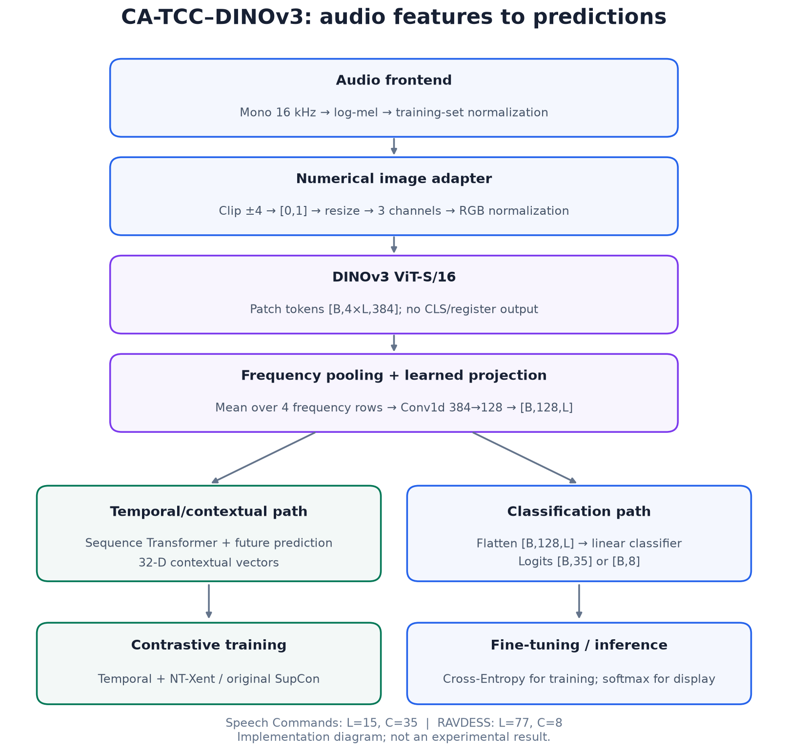
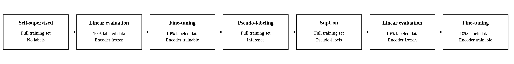
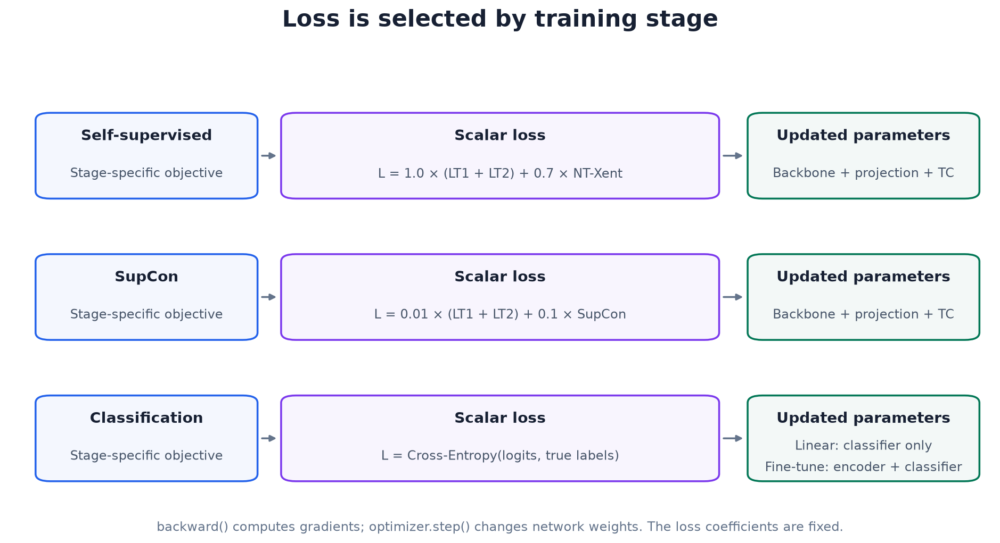
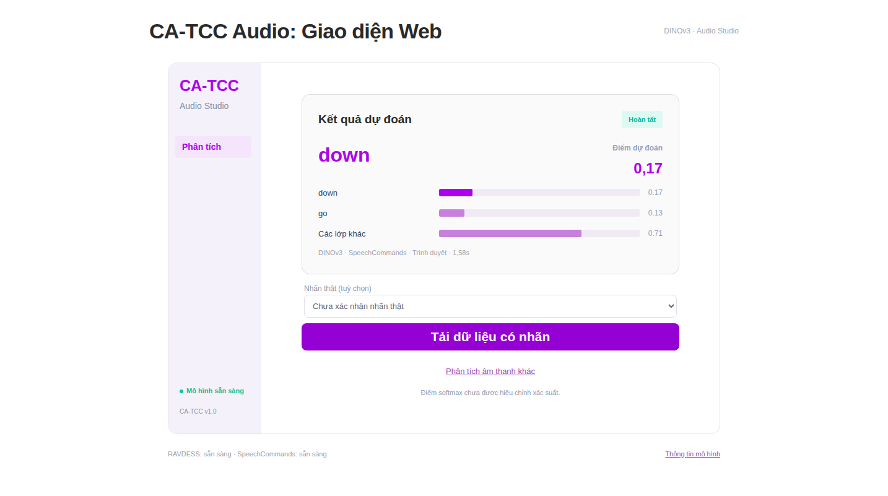

# CA-TCC with DINOv3 for Audio Classification

This document describes the original DINOv3 integration and the experiments completed on **17–18 October 2026**. It covers the original CA-TCC training objectives and the corresponding evaluated checkpoints.

The project adapts CA-TCC to **Speech Commands v0.02** (35 English keyword classes) and **RAVDESS Speech** (8 speech-emotion classes). A separate DINOv3 ViT-S/16 encoder replaces the baseline CNN while retaining CA-TCC's temporal/contextual learning pipeline. The contribution is audio preprocessing, backbone integration and evaluation; CA-TCC, DINOv3 and the datasets are inherited resources.

## Reading guide

1. [DINOv3 integration](#1-dinov3-integration): architecture, tensor shapes and source functions.
2. [Trainable/frozen components](#2-trainable-and-frozen-components): stage policy and checkpoint hand-offs.
3. [Loss functions and updates](#3-loss-functions-and-weight-updates): equations, exact original code, gradient paths and interpretation.
4. [Verification/results](#4-verification-and-experimental-results): recorded checks, validation and test results.
5. [Reproduction/artifacts](#5-reproduction-configuration-and-saved-artifacts): commands, checkpoint identity and logs.

Source excerpts below come from the archived **18 October experiment snapshot**, so the documented loss implementation is tied to the evaluated version. Implementation diagrams explain the architecture and objectives; they are not experimental results. Numerical results are presented as tables with links to the recorded histories and metrics, without redrawn result charts.

## 1. DINOv3 integration



### Where the encoder is replaced

[DinoSequenceEncoder and DinoAudioModel](variants/dinov3/model.py) replace the baseline's three CNN blocks from [models/model.py](models/model.py). The integration is isolated in `variants/dinov3/`; the baseline entry point, trainer, and loss definitions are retained.

| File | Responsibility |
|---|---|
| [model.py](variants/dinov3/model.py) | Local pretrained backbone, log-mel adapter, patch-token aggregation, projection, classifier, freezing policy |
| [main.py](variants/dinov3/main.py) | Stage initialization, checkpoint loading, Adam optimizers, resolved configuration and provenance |
| [trainer.py](variants/dinov3/trainer.py) | Forward/backward/update loop, validation selection, history and checkpoint persistence |
| [models/loss.py](models/loss.py) | Original NT-Xent and SupCon loss implementations shared with CA-TCC |
| [pipeline.py](variants/dinov3/pipeline.py) | Ordered training stages and experiment-specific data/pseudo-label paths |
| [models/TC.py](models/TC.py) | Shared temporal prediction and contextual projection module |

### Data flow and tensor shapes

```text
WAV → mono, 16 kHz → fixed-duration waveform → log-mel
    → normalization using training-set statistics [B, 40, T]
    → clip to [-4, 4], map to [0, 1], bilinear resize
    → repeat into 3 channels, apply fixed RGB normalization
    → pretrained DINOv3 ViT-S/16 → x_norm_patchtokens
    → reshape frequency × time patch grid, average frequency rows
    → Conv1d(384, 128, kernel_size=1) → temporal features [B, 128, L]
        ├─ training: temporal/contextual module → contrastive objectives
        └─ classification: flatten → linear classifier → logits [B, C]
```

`B` is batch size. The adapter consumes patch tokens rather than CLS/register tokens; it preserves a time sequence for CA-TCC. No PNG rendering or spectrogram colormap is used.

| Tensor | Speech Commands | RAVDESS |
|---|---|---|
| Waveform window | 1 second / 16,000 samples | 6 seconds / 96,000 samples |
| Normalized log-mel | `[B,40,101]` | `[B,40,601]` |
| DINOv3 image input | `[B,3,64,240]` | `[B,3,64,1232]` |
| Patch grid / tokens | `4×15` / `[B,60,384]` | `4×77` / `[B,308,384]` |
| After frequency averaging | `[B,384,15]` | `[B,384,77]` |
| After learned projection | `[B,128,15]` | `[B,128,77]` |
| Classification logits | `[B,35]` | `[B,8]` |

The temporal module uses a 100-dimensional context and projects it to 32-dimensional contextual vectors for contrastive learning. RGB mean is `[0.485,0.456,0.406]`; standard deviation is `[0.229,0.224,0.225]`. This conversion from log-mel to a visual backbone is a project-specific adapter, not an official DINOv3 audio recipe.

### Model construction and the classifier interface

The encoder/classifier boundary is explicit in `DinoAudioModel`. Both encoders must supply a temporal sequence compatible with CA-TCC; the DINOv3 version learns a 384→128 projection rather than substituting a single global CLS vector.

```python
def __init__(self, config, repo, weights=None, initialization='pretrained', image_height=64,
             clip_z=4.0, backbone_policy='trainable'):
    super().__init__()
    if backbone_policy not in ('trainable', 'frozen'):
        raise ValueError('backbone_policy must be trainable or frozen')
    self.encoder = DinoSequenceEncoder(config, repo, weights, initialization, image_height, clip_z)
    self.logits = nn.Linear(config.final_out_channels * config.features_len, config.num_classes)
    self.backbone_policy = backbone_policy
    self.linear_probe = False
    self.configure_stage('self_supervised')
```

```python
def forward(self, x):
    features = self.encoder(x)
    return self.logits(features.flatten(1)), features
```

The classifier receives `128×15=1,920` values for Speech Commands or `128×77=9,856` for RAVDESS. During contrastive stages the classifier logits may be computed, but the loss uses sequence/contextual features instead.

### Loading the official pretrained backbone

The constructor creates the official `dinov3_vits16` architecture locally and loads an explicit state dict. No fallback silently changes a missing pretrained checkpoint into a random-initialization experiment.

```python
# DinoSequenceEncoder.__init__ — excerpt; local import/path checks omitted.
self.backbone = backbones.dinov3_vits16(pretrained=False)
# ...
if initialization == 'pretrained':
    state = torch.load(Path(weights).expanduser(), map_location='cpu', weights_only=True)
    self.backbone.load_state_dict(state, strict=True)
```

The source and checkpoint hashes are stored in `run_config.json`/source provenance. This is local loading, not a new visual pretraining run.

### Adapter forward pass: exactly how patch tokens become a sequence

The following function is from [DinoSequenceEncoder.forward](variants/dinov3/model.py). Each operation corresponds to the data flow and shape table above.

```python
def forward(self, x):
    if x.ndim != 3 or x.shape[1] != self.input_channels:
        raise ValueError('Expected normalized log-mel tensor [batch, 40, time].')
    # Fixed scaling of TRAIN-normalized inputs; no per-image or test-set fitting.
    image = (x.clamp(-self.clip_z, self.clip_z) / self.clip_z + 1.0) * 0.5
    image = F.interpolate(image.unsqueeze(1), size=(self.image_height, self.image_width),
                          mode='bilinear', align_corners=False)
    image = (image.repeat(1, 3, 1, 1) - self.image_mean) / self.image_std
    with torch.set_grad_enabled(torch.is_grad_enabled() and not self.backbone_frozen):
        tokens = self.backbone.forward_features(image)['x_norm_patchtokens']
    height, width = self.image_height // 16, self.sequence_length
    if tokens.shape[1] != height * width:
        raise RuntimeError('Unexpected DINOv3 patch grid; check upstream API/version.')
    # Patch order is row-major: frequency rows x time columns. Exclude CLS/registers.
    sequence = tokens.reshape(x.shape[0], height, width, 384).mean(dim=1)
    return self.projection(sequence.transpose(1, 2).float())
```

The frequency mean reduces four patch rows without adding learned parameters. The `Conv1d` projection is learned. CLS/register tokens are excluded **from the selected output token array**; this does not mean those tokens have been removed from DINOv3's internal attention.

## 2. Trainable and frozen components



The following describes the evaluated **`--backbone-policy trainable`** configuration. “Updated” means a component participates in the loss and receives optimizer updates; being present in an optimizer or having `requires_grad=True` alone does not imply an update.

| Stage | Labels/data | DINOv3 backbone | 384→128 projection | Classifier | Temporal/contextual module |
|---|---|---|---|---|---|
| `self_supervised` | Full training set; labels not used by the objective | Updated | Updated | Unused by loss | Updated |
| `train_linear_10p` | 10% true-labeled training subset | Frozen, eval mode | Frozen, eval mode | Updated | Unused |
| `ft_10p` | 10% true-labeled training subset | Updated | Updated | Updated | Unused |
| `gen_pseudo_labels` | Full training set | Inference only | Inference only | Inference only | Unused |
| `SupCon` | Full training set with generated pseudo-labels | Updated | Updated | Unused by loss | Updated |
| `train_linear_SupCon_10p` | 10% true-labeled training subset | Frozen, eval mode | Frozen, eval mode | Updated | Unused |
| `ft_SupCon_10p` | 10% true-labeled training subset | Updated | Updated | Updated | Unused |

The alternative `frozen` policy freezes the backbone outside linear probing as well; it is not the policy used for the reported training runs. At inference, only the encoder, projection and classifier are required.

Each stage starts its own optimizer. Linear/fine-tuning stages load encoder weights from the corresponding self-supervised/SupCon stage while excluding classifier weights. Pseudo-label generation loads the selected `ft_10p` classifier. SupCon starts from that fine-tuned model. The final fine-tune loads the SupCon encoder, not the preceding linear-probe classifier. See [stage loading and configuration](variants/dinov3/main.py).

### The freezing functions, rather than a verbal assumption

`configure_stage()` resets the stage's `requires_grad` flags, freezes the whole encoder for linear evaluation, and applies the optional backbone-only policy:

```python
def configure_stage(self, training_mode):
    self.linear_probe = 'train_linear' in training_mode
    for parameter in self.parameters():
        parameter.requires_grad_(True)
    if self.linear_probe:
        for parameter in self.encoder.parameters():
            parameter.requires_grad_(False)
    freeze_backbone = self.linear_probe or self.backbone_policy == 'frozen'
    self.encoder.backbone_frozen = freeze_backbone
    if freeze_backbone:
        for parameter in self.encoder.backbone.parameters():
            parameter.requires_grad_(False)
    self.train(self.training)
```

The overridden `train()` also keeps the frozen encoder in evaluation mode. `requires_grad=False` and `eval()` serve different purposes: the first blocks parameter gradients; the second controls mode-dependent behavior.

```python
def train(self, mode=True):
    super().train(mode)
    if self.linear_probe:
        self.encoder.eval()
    elif self.encoder.backbone_frozen:
        self.encoder.backbone.eval()
    return self
```

Inside the encoder, `torch.set_grad_enabled(... and not self.backbone_frozen)` determines whether the backbone forward builds an autograd graph. The projection lies outside that guarded block. Thus the frozen-backbone policy can still train a projection, while linear probing freezes both.

## 3. Loss functions and weight updates

The objectives below train an audio model containing a pretrained DINOv3 backbone. They are not DINOv3's original visual pretraining losses. Their implementations are in [models/loss.py](models/loss.py) and [models/TC.py](models/TC.py), with stage selection and backward/update logic in [the DINOv3 trainer](variants/dinov3/trainer.py).

### Loss interface: inputs, outputs and labels



| Function / location | Inputs | Output | What receives gradients |
|---|---|---|---|
| `TC.forward`, `models/TC.py` | Two normalized sequences `[B,128,L]` | Temporal scalar plus contextual vector `[B,32]` | Backbone, sequence projection and TC when used by a contrastive loss |
| `NTXentLoss.forward`, `models/loss.py` | Context vectors for two views `[B,32]` each | Scalar mean contrastive loss | Both context branches; no label input |
| `SupConLoss.forward`, `models/loss.py` | `[B,2,32]` vectors and `[B]` pseudo-labels | Scalar SupCon loss | Both context branches; labels themselves are discrete targets |
| `nn.CrossEntropyLoss`, trainer | Raw logits `[B,C]` and integer labels `[B]` | Scalar classification loss | Classifier and enabled encoder parameters |

**Fine-tuning DINOv3 for classification uses Cross-Entropy.** The SupCon objective is an earlier, separate representation-learning stage. The project does not use DINOv3 teacher/student distillation or an additional DINO-specific visual loss in the audio pipeline.

### Temporal prediction loss

The [TC module](models/TC.py) selects a time position, encodes the preceding sequence into a context vector, and predicts future features over six steps. It computes an in-batch negative log-softmax objective, averaged over samples and prediction steps. Both augmentation directions are evaluated:

$$
\mathcal L_T=\mathcal L_T(1\rightarrow2)+\mathcal L_T(2\rightarrow1).
$$

Sequence features are normalized along their channel dimension before entering TC. TC also projects its 100-dimensional context into a 32-dimensional vector for the contextual objective.

### Temporal objective and its implementation

For one direction, let `e_(i,k)` be sample `i`'s true feature at future step `k`, and `q_(j,k)=W_k c_j` be the prediction from sample `j`'s context. Define `S_(i,j,k)=e_(i,k)^T q_(j,k)`. The code uses row-wise softmax:

$$
\mathcal L_T^{1\to2}=-\frac{1}{BK}\sum_{k=1}^{K}\sum_{i=1}^{B}
\log\frac{\exp(S_{i,i,k})}{\sum_{j=1}^{B}\exp(S_{i,j,k})},\qquad K=6.
$$

The matching sample is the diagonal entry; other samples in the batch act as negatives. A random context time is chosen on each TC call, and the two directions are evaluated separately.

```python
# models/TC.py — excerpt after future targets/context have been prepared.
c_t = self.seq_transformer(forward_seq)
pred = torch.empty((self.timestep, batch, self.num_channels)).float().to(self.device)
for i in np.arange(0, self.timestep):
    linear = self.Wk[i]
    pred[i] = linear(c_t)
for i in np.arange(0, self.timestep):
    total = torch.mm(encode_samples[i], torch.transpose(pred[i], 0, 1))
    nce += torch.sum(torch.diag(self.lsoftmax(total)))
nce /= -1. * batch * self.timestep
return nce, self.projection_head(c_t)
```

The returned contextual vector is a separate output from the scalar temporal objective. The two are not interchangeable: one supplies a representation to NT-Xent/SupCon, the other contributes directly to the weighted total.

### Self-supervised stage

$$
\mathcal L_{\mathrm{SSL}}=1.0\,\mathcal L_T+0.7\,\mathcal L_{\mathrm{NT\text{-}Xent}}.
$$

[NTXentLoss](models/loss.py) uses two augmented views of each sample as a positive pair, with other samples as negatives. The evaluated configuration uses cosine similarity and temperature `0.2`. This stage uses the full training set without consuming class labels in its objective.

### NT-Xent: the contextual objective without labels

For `2B` view vectors and the paired other-view index `p(i)`, the implemented mean objective is:

$$
\mathcal L_{\mathrm{NT\text{-}Xent}}=-\frac{1}{2B}\sum_{i=1}^{2B}
\log\frac{\exp(\operatorname{cos}(h_i,h_{p(i)})/\tau)}
{\sum_{a\ne i}\exp(\operatorname{cos}(h_i,h_a)/\tau)}.
$$

The positive is retained in the denominator; self-pairs are excluded. In the implementation, the positive occupies column zero and is followed by negatives. Cross-Entropy target zero therefore means “select the positive column”, not dataset class zero.

<details>
<summary><strong>Original NTXentLoss.forward implementation</strong></summary>

```python
def forward(self, zis, zjs):
    representations = torch.cat([zjs, zis], dim=0)

    similarity_matrix = self.similarity_function(representations, representations)

    # filter out the scores from the positive samples
    l_pos = torch.diag(similarity_matrix, self.batch_size)
    r_pos = torch.diag(similarity_matrix, -self.batch_size)
    positives = torch.cat([l_pos, r_pos]).view(2 * self.batch_size, 1)

    negatives = similarity_matrix[self.mask_samples_from_same_repr].view(2 * self.batch_size, -1)

    logits = torch.cat((positives, negatives), dim=1)
    logits /= self.temperature

    labels = torch.zeros(2 * self.batch_size).to(self.device).long()
    loss = self.criterion(logits, labels)

    return loss / (2 * self.batch_size)
```

</details>

`_get_correlated_mask()` removes the diagonal and paired-view positions from the negative set. The paired similarities are then added back explicitly as the positive column. The cosine option normalizes similarity internally; temperature scales the logits before Cross-Entropy.

### Supervised contrastive stage

$$
\mathcal L_{\mathrm{SupCon\ stage}}=0.01\,\mathcal L_T+0.1\,\mathcal L_{\mathrm{SupCon}}.
$$

The implementation uses labels generated by the preceding `ft_10p` model. Two views with the same pseudo-label are positives; a vector is excluded from matching itself, while the other view of the same sample remains a positive.

For contextual vectors `h`, define `s(i,a)=h_i^T h_a / τ`, where `τ=0.2`. With `P(i)` denoting the positive indices and `N=2B` views, the original [SupConLoss](models/loss.py) computes:

$$
\mathcal L_{\mathrm{SupCon}}=
-\tau\frac{1}{N}\sum_{i=1}^{N}\frac{1}{|P(i)|}
\sum_{p\in P(i)}\log\frac{\exp(s(i,p))}{\sum_{a\ne i}\exp(s(i,a))}.
$$

The original code uses contextual dot products, subtracts each row maximum for numerical stability, and applies the `-τ` prefactor. These details matter when interpreting the coefficient `0.1`.

### SupCon: positive/negative masks and exact reduction

This section follows the original `SupConLoss.forward()` in [models/loss.py](models/loss.py). The input is a contextual feature tensor `[B,2,32]` and one pseudo-label per sample `[B]`. With `contrast_mode='all'`, both augmented views act as anchors, producing `2B` anchors and `2B` contrast vectors.

**Positive pairs and self exclusion.** The code first builds a `[B,B]` label-equality mask. It repeats that mask across the two views to obtain `[2B,2B]`, then sets the diagonal to zero. For each anchor, the remaining vectors with the same pseudo-label are positives; vectors with different pseudo-labels are negatives. The other view of the same sample remains a positive, so each anchor has at least one positive in this two-view configuration.

```python
# models/loss.py — SupConLoss.forward excerpts.
labels = labels.contiguous().view(-1, 1)
mask = torch.eq(labels, labels.T).float().to(device)
# ... after concatenating all views:
mask = mask.repeat(anchor_count, contrast_count)
logits_mask = torch.scatter(
    torch.ones_like(mask), 1,
    torch.arange(batch_size * anchor_count).view(-1, 1).to(device), 0
)
mask = mask * logits_mask
```

The two masks serve different purposes: `mask` selects positive pairs for the numerator average, while `logits_mask` excludes only self-pairs from the denominator. Negative pairs are not separately selected into another mask; they remain among the non-self terms in the denominator.

**Similarity and log probability.** Contextual dot products are divided by temperature `0.2`; subtracting the row maximum stabilizes the exponentials. The denominator sums over **all non-self views**, including both positives and negatives. The code then computes one log probability for every anchor/contrast pair.

**Exact reduction to a scalar.** For each anchor, the code averages log probabilities over its positive pairs. It multiplies by the original `-temperature` prefactor, reshapes to `[2,B]`, then averages over views and samples:

```python
# models/loss.py — original log-probability/reduction code.
exp_logits = torch.exp(logits) * logits_mask
log_prob = logits - torch.log(exp_logits.sum(1, keepdim=True))
mean_log_prob_pos = (mask * log_prob).sum(1) / mask.sum(1)
loss = - self.temperature * mean_log_prob_pos
loss = loss.view(anchor_count, batch_size).mean()
return loss
```

The returned value is the unweighted SupCon scalar. The trainer multiplies it by **0.1** and adds **0.01** times the bidirectional temporal loss. These coefficients weight objective terms; they are not network parameters learned by the optimizer.

Unlike NT-Xent's cosine setting, this original SupCon implementation directly uses contextual dot products. Channel-wise normalization of sequence features before TC does not imply unit-length final contextual vectors. Consequently, vector magnitude, temperature, pseudo-label quality and pair composition all influence this objective. A low scalar loss alone does not demonstrate better classification accuracy.

### Where the original trainer assembles both contrastive losses

This is an excerpt of `model_train()` from the original experiment's archived trainer. It shows the two encoder views, temporal/contextual outputs, exact coefficients and classification alternative in one place:

```python
if training_mode == "self_supervised" or training_mode == "SupCon":
    predictions1, features1 = model(aug1)
    predictions2, features2 = model(aug2)

    # normalize projection feature vectors
    features1 = F.normalize(features1, dim=1)
    features2 = F.normalize(features2, dim=1)

    temp_cont_loss1, temp_cont_feat1 = temporal_contr_model(features1, features2)
    temp_cont_loss2, temp_cont_feat2 = temporal_contr_model(features2, features1)

if training_mode == "self_supervised":
    lambda1 = 1
    lambda2 = 0.7
    nt_xent_criterion = NTXentLoss(device, data.shape[0], config.Context_Cont.temperature,
                                   config.Context_Cont.use_cosine_similarity)
    loss = (temp_cont_loss1 + temp_cont_loss2) * lambda1 + \
           nt_xent_criterion(temp_cont_feat1, temp_cont_feat2) * lambda2

elif training_mode == "SupCon":
    lambda1 = 0.01
    lambda2 = 0.1
    Sup_contrastive_criterion = SupConLoss(device)

    supCon_features = torch.cat([temp_cont_feat1.unsqueeze(1), temp_cont_feat2.unsqueeze(1)], dim=1)
    loss = (temp_cont_loss1 + temp_cont_loss2) * lambda1 + Sup_contrastive_criterion(supCon_features,
                                                                                     labels) * lambda2

else:
    output = model(data)
    predictions, features = output
    loss = criterion(predictions, labels)
    total_acc += labels.eq(predictions.detach().argmax(dim=1)).sum().item()
```

The coefficients are fixed hyperparameters:

| Stage | Temporal coefficient | Contextual coefficient | Contextual criterion | Label source |
|---|---:|---:|---|---|
| `self_supervised` | 1.0 | 0.7 | NT-Xent, temperature 0.2 | No class labels |
| `SupCon` | 0.01 | 0.1 | Original SupCon, temperature 0.2 | Generated pseudo-labels |
| Linear / fine-tune | Not used | Not used | Cross-Entropy | True labels from the 10% subset |

Changing a coefficient changes the relative gradient contribution. A smaller total loss from one stage is not directly comparable to another stage's loss because both the formula and coefficient scale differ. These recorded coefficients were retained from CA-TCC; they were not independently optimized in the six-trial LR/weight-decay search.

### Linear evaluation and classification fine-tuning

These stages use Cross-Entropy on true labels:

$$
\mathcal L_{\mathrm{CE}}=-\frac{1}{B}\sum_{i=1}^{B}\log\operatorname{softmax}(z_i)_{y_i}.
$$

During linear probing, only the classifier learns. During fine-tuning, gradients reach the DINOv3 backbone, the 384→128 projection and the classifier. TC is not part of the classification-loss path. **Cross-Entropy and SupCon are used in separate stages**, not added together in the final fine-tune step.

### Classification code: raw logits go to Cross-Entropy

```python
# Original DINOv3 trainer — classification path, excerpt.
criterion = nn.CrossEntropyLoss()
# ... inside model_train for a classification stage:
output = model(data)
predictions, features = output
loss = criterion(predictions, labels)
```

`predictions` contains raw logits `[B,35]` or `[B,8]`. Do not apply softmax before `nn.CrossEntropyLoss`; it already applies the log-softmax-based reduction. Softmax is used later to display prediction scores. Neither labels nor the scalar loss itself is an inference output: inference returns logits/features, from which the predicted label is derived.

### How and where parameters are updated

The [DINOv3 entry point](variants/dinov3/main.py) creates two Adam optimizers: one for enabled model parameters, another for TC. The [trainer](variants/dinov3/trainer.py) computes the appropriate scalar loss and applies:

```python
model_optimizer.zero_grad()
temp_cont_optimizer.zero_grad()
# Model forward pass and stage-specific loss computation.
loss.backward()
model_optimizer.step()
temp_cont_optimizer.step()
```

`backward()` computes gradients; `optimizer.step()` changes participating network weights. Adam skips parameters with no gradient. Thus an unused classifier does not learn in contrastive stages, and the unused TC module does not learn in classification stages. The loss function and fixed coefficients themselves are not learned parameters.

The final runs use initial LR `1e-4`, weight decay `3e-4` and Adam betas `(0.9,0.99)`. Classification stages apply `ReduceLROnPlateau` using validation Cross-Entropy. Each stage starts its own optimizer; this is not one continuously resumed optimizer across the full pipeline.

### Three different meanings of “weight”

| Quantity | Example in this project | How it is determined |
|---|---|---|
| Loss coefficient | `lambda1=0.01`, `lambda2=0.1` in SupCon | Fixed hyperparameter multiplying a loss term; not learned by Adam |
| Network weight | DINOv3 attention/MLP parameters, projection and classifier matrices | Learned through gradients and optimizer steps when active |
| Optimizer weight decay | `3e-4` in Adam | Regularization setting; not the contextual-loss coefficient |

The learning rate (`1e-4` initially) controls the optimizer's update scale. It is not a loss coefficient either. Saying “the loss updates DINOv3” means that gradients of the scalar objective guide network-weight updates; it does not mean the loss formula is itself a trainable model.

### Chain rule: why the loss updates DINOv3

For a classification example, the computation is `z = classifier(flatten(projection(DINOv3(adapter(x)))))`. With backbone parameters `θ`, projection parameters `φ` and classifier parameters `ψ`, autograd computes:

$$
\frac{\partial\mathcal L_{\mathrm{CE}}}{\partial\theta}
=\frac{\partial\mathcal L_{\mathrm{CE}}}{\partial z}
\frac{\partial z}{\partial f_{\theta,\phi}(x)}
\frac{\partial f_{\theta,\phi}(x)}{\partial\theta}.
$$

This chain exists only when the backbone forward is tracked and its parameters are enabled. For contrastive stages, the gradient instead passes through contextual/temporal operations back into the same encoder. During linear probing, the encoder's graph is disabled/frozen, so only classifier weights are updated.

The original optimizers are configured in `variants/dinov3/main.py`:

```python
model_optimizer = torch.optim.Adam(
    (p for p in model.parameters() if p.requires_grad),
    lr=configs.lr, betas=(configs.beta1, configs.beta2),
    weight_decay=args.weight_decay
)
temporal_contr_optimizer = torch.optim.Adam(
    temporal_contr_model.parameters(), lr=configs.lr,
    betas=(configs.beta1, configs.beta2), weight_decay=args.weight_decay
)
```

The entry point passes `temporal_contr_optimizer` into the trainer argument named `temp_cont_optimizer`. This is the same optimizer despite the different local variable names.

| Operation | What it changes | What it does not establish |
|---|---|---|
| Forward | Produces logits/features and scalar loss | Does not update weights |
| `loss.backward()` | Fills parameter `.grad` along active graph paths | Does not itself perform the optimizer update |
| `optimizer.step()` | Updates parameters with gradients using Adam state and weight decay | Does not change the loss formula or guarantee better validation/test accuracy |
| Validation selection | Chooses a classifier checkpoint by minimum validation CE | Does not optimize on the test set |

The documented verification establishes successful forward/backward/step execution; it does not provide a historical per-parameter gradient-count audit. The trainability table describes the implemented paths, rather than claiming that every tensor must have a nonzero gradient in every batch.

## 4. Verification and experimental results

### Recorded implementation checks

- Official ViT-S/16 weights were verified by SHA-256 and loaded with `strict=True`.
- Recorded GPU probes passed at batch 8 for both datasets, including self-supervised, SupCon, fine-tuning and linear-probe execution. RAVDESS batch 32 exceeded the GTX 1650 memory budget, so the experiments use batch 8.
- Four recorded preflight tests passed, covering missing-checkpoint handling, failed-trial recording, validation-based winner selection/resume and validation-only training behavior.
- Exported CPU TorchScript models passed tensor and real-validation-WAV parity checks. The HTTP API passed real-WAV checks for both datasets, including agreement with direct model inference.
- Browser inference checks compared real ONNX predictions against the exported CPU model and verified the sequential UI, responsive layout and CSV download.

These checks establish execution and deployment consistency; they do not establish high classification accuracy or superiority over the CNN baseline. GPU probes and smoke checks are distinct from full training/test results.

Evidence: [preflight report](artifacts/dinov3_preflight_20261017/REPORT.md), [recorded tests](artifacts/dinov3_preflight_20261017/tests.log), [pretrained GPU probe](artifacts/dinov3_preflight_20261017/pretrained_probe.json), [RAVDESS export checks](artifacts/dinov3_app_bundles/RAVDESS/verification.json), [Speech Commands export checks](artifacts/dinov3_app_bundles/SpeechCommands/verification.json), [API checks](artifacts/dinov3_app_bundles/api_verification.json), [RAVDESS browser checks](artifacts/audio_studio_web_20261018/browser_verification.json), [Speech Commands browser checks](artifacts/audio_studio_web_20261018/speechcommands-browser_verification.json).

### Successful RAVDESS parameter trials

Each trial uses pretrained DINOv3, 10% labels, batch 8, seed 0 and 10 epochs per learning stage. Values below are from the selected `ft_SupCon_10p` validation checkpoint.

| Trial | Initial LR | Weight decay | Selected epoch | Validation CE | Validation accuracy |
|---|---:|---:|---:|---:|---:|
| t00 | 1e-05 | 0.0001 | 6 | 1.806568 | 33.75% |
| t01 | 1e-05 | 0.0003 | 3 | 1.850943 | 27.92% |
| t02 | 3e-05 | 0.0001 | 1 | 1.846157 | 27.08% |
| t03 | 3e-05 | 0.0003 | 2 | 1.822803 | 24.58% |
| t04 | 0.0001 | 0.0001 | 9 | 1.765119 | 28.33% |
| t05 | 0.0001 | 0.0003 | 8 | 1.702606 | 31.25% |

Trial **t05**, LR **1e-4**, weight decay **3e-4**, was selected by **minimum validation CE (1.702606)**. Trial t00 has higher validation accuracy but a worse CE; accuracy was not the selection criterion. Test data were not used to tune the grid. Source: [trials.csv](artifacts/dinov3_search_10p_20261017/trials.csv).

RAVDESS was then trained independently with the selected hyperparameters for 40 epochs per stage. The same hyperparameters were transferred to Speech Commands, initialized independently from official pretrained DINOv3, with a reduced four-epoch-per-stage budget. RAVDESS-fine-tuned weights were not transferred to Speech Commands.

### Reading the recorded loss values correctly

The original histories record a weighted total for contrastive stages and plain Cross-Entropy for classification. The following are **last-epoch training losses**, not validation scores or test accuracy:

| Dataset | Stage | Last epoch | Recorded training loss | Meaning |
|---|---|---:|---:|---|
| RAVDESS | `self_supervised` | 40 | 1.369587 | 1.0 × bidirectional temporal + 0.7 × NT-Xent |
| RAVDESS | `SupCon` | 40 | 0.049293 | 0.01 × bidirectional temporal + 0.1 × original SupCon |
| RAVDESS | `ft_SupCon_10p` | 40 | 0.781665 | Cross-Entropy on the true-labeled subset |
| SpeechCommands | `self_supervised` | 4 | 0.420467 | 1.0 × bidirectional temporal + 0.7 × NT-Xent |
| SpeechCommands | `SupCon` | 4 | 0.024871 | 0.01 × bidirectional temporal + 0.1 × original SupCon |
| SpeechCommands | `ft_SupCon_10p` | 4 | 2.240836 | Cross-Entropy on the true-labeled subset |

A small SupCon total cannot be interpreted as “better than Cross-Entropy” because its terms have different scales and coefficients. Raw temporal/contextual contributions were not separately stored in these original histories; they are not reconstructed or invented here. For RAVDESS, the last epoch is 40 but the final classifier selected by validation CE is epoch 3. Test evaluates that selected checkpoint, not necessarily the last weights.

### Validation results from the final runs

The table reports the checkpoint selected by minimum validation CE, not by peak validation accuracy or the last epoch. For RAVDESS final fine-tuning, epoch 3 was selected from a 40-epoch run. Per-epoch values are available in the saved `history.json` files.

| Dataset | Stage | Epoch budget | Selected epoch | Validation CE | Validation accuracy |
|---|---|---:|---:|---:|---:|
| RAVDESS | `train_linear_10p` | 40 | 14 | 1.768886 | 28.33% |
| RAVDESS | `ft_10p` | 40 | 10 | 1.711033 | 25.00% |
| RAVDESS | `train_linear_SupCon_10p` | 40 | 18 | 1.750028 | 29.58% |
| RAVDESS | `ft_SupCon_10p` | 40 | 3 | 1.768191 | 22.50% |
| SpeechCommands | `train_linear_10p` | 4 | 3 | 3.542608 | 4.59% |
| SpeechCommands | `ft_10p` | 4 | 4 | 1.582264 | 53.17% |
| SpeechCommands | `train_linear_SupCon_10p` | 4 | 4 | 2.797421 | 20.31% |
| SpeechCommands | `ft_SupCon_10p` | 4 | 4 | 2.245166 | 32.24% |

Self-supervised and SupCon stages optimize contrastive objectives rather than classification validation CE; they do not have a classification accuracy to report here. Their per-epoch losses remain in the corresponding `history.json` files.

### Held-out test results

All rows use seed 0 and the selected final `ft_SupCon_10p` classifier. Speech Commands has 11,005 test samples; RAVDESS has 240.

| Dataset | Encoder | Epochs per learning stage | Accuracy | Macro-F1 | Balanced accuracy |
|---|---|---:|---:|---:|---:|
| RAVDESS | Original CNN | 40 | 23.75% | 20.05% | 22.27% |
| RAVDESS | DINOv3 | 40 | 24.17% | 18.54% | 22.66% |
| Speech Commands | Original CNN | 40 | 85.48% | 84.38% | 84.33% |
| Speech Commands | DINOv3 | 4 | 31.02% | 23.54% | 25.25% |

Sources: [CNN metrics](artifacts/full_audio_10p_seed0_20261017/metrics_summary.csv), [RAVDESS final test metrics](experiments_logs/dinov3_search_10p_20261017_ravdess_final/RAVDESS/ft_SupCon_10p_seed_0/winner_test_metrics.json), [Speech Commands final test metrics](experiments_logs/dinov3_speechcommands_ravdess_best_10p_20261018/SpeechCommands/ft_SupCon_10p_seed_0/winner_test_metrics.json).

### Limits of interpretation

- DINOv3 did not demonstrate a clear improvement: RAVDESS accuracy increases by only one correctly classified test sample, while macro-F1 decreases.
- The Speech Commands runs have different budgets: CNN 40 versus DINOv3 4 epochs per stage. The CNN uses batch 32, while DINOv3 uses batch 8.
- Results use one seed and one split. External visual pretraining, the log-mel adapter, pseudo-label quality and training budget all affect the comparison.
- The inherited 10% label budget applies to true-labeled classification stages; contrastive stages can use the full training set. It does not mean every stage uses only 10% of the audio.
- These are English speech datasets. Performance on Vietnamese audio is not established, and softmax outputs are not calibrated confidence estimates.

## 5. Reproduction, configuration and saved artifacts

### Local prerequisites

Prepare the datasets and environment using [datasets/README.md](datasets/README.md), [requirements-audio.txt](requirements-audio.txt) and the [audio reproduction guide](docs/REPRODUCE_AUDIO_VI.md). The measured setup uses PyTorch `2.5.1+cu121` and an NVIDIA GTX 1650 with 4 GB VRAM.

Training requires a local official [DINOv3 checkout](https://github.com/facebookresearch/dinov3) in `external/dinov3/`, authorized ViT-S/16 weights at `weights/dinov3_vits16.pth`, and prepared tensors/normalization in `datasets/tensors/full/`. The runner checks baseline-completion artifacts through [common.py](variants/dinov3/common.py). A source-only Git checkout does not include these large local assets. Once all prerequisites are present, training can run offline.

| Setting | RAVDESS final | Speech Commands final |
|---|---|---|
| Initialization | Official DINOv3 ViT-S/16 pretrained | Same pretrained source, independent initialization |
| Initial LR / weight decay | `1e-4` / `3e-4` | `1e-4` / `3e-4` |
| Batch / seed | 8 / 0 | 8 / 0 |
| True-label budget | 10% | 10% |
| Epochs per learning stage | 40 | 4 |
| Backbone policy | Trainable outside linear probing | Same |
| Classifier selection | Minimum validation CE | Same |
| Temporal/contextual SSL weights | `1.0 / 0.7` | Same |
| Temporal/contextual SupCon weights | `0.01 / 0.1` | Same |
| Contextual temperature | `0.2` | `0.2` |

Pretrained weights SHA-256: `08c60483bc63c04f533611e34bf70b120eedb7240f469bc16e9e20bf344b941d`.

### Commands

The following commands document the original objective configuration: do not pass a custom `--loss-config`. Use a new experiment name to avoid overwriting recorded results.

```bash
# RAVDESS: full pipeline, with test excluded while training/choosing checkpoints.
.venv-dinov3/bin/python variants/dinov3/pipeline.py \
  --experiment dinov3_ravdess_original_repro \
  --datasets RAVDESS --source-data-root datasets/tensors/full \
  --label-percent 10 --epochs 40 --batch-size 8 --seed 0 --device cuda:0 \
  --dinov3-repo external/dinov3 --dinov3-weights weights/dinov3_vits16.pth \
  --initialization pretrained --backbone-policy trainable \
  --learning-rate 1e-4 --weight-decay 3e-4 --validation-only

# Evaluate the selected final RAVDESS classifier only after training completes.
.venv-dinov3/bin/python -c 'from variants.dinov3.search import evaluate_winner; evaluate_winner("dinov3_ravdess_original_repro", "RAVDESS", 0)'

# Speech Commands: fixed original LR/WD and four epochs per stage.
# The supervisor performs final test evaluation after pipeline completion.
.venv-dinov3/bin/python -u scripts/run_dinov3_fixed.py \
  --experiment dinov3_speechcommands_original_repro --epochs 4
```

To continue an interrupted run, repeat its command with `--resume` and identical settings. Do not reuse an experiment name for a different configuration. Exact historical source revisions and environment versions are captured in each experiment's source snapshot and package list; a nominally equal seed does not guarantee identical floating-point outcomes on every environment.

### Checkpoints and logs

The documented experiments are:

```text
dinov3_search_10p_20261017_ravdess_final
dinov3_speechcommands_ravdess_best_10p_20261018
```

For either experiment, local artifacts follow this layout:

```text
artifacts/<experiment>/
  README.md
  pipeline.log
  source_snapshot.zip
  source_sha256.json
  packages.log

experiments_logs/<experiment>/
  pipeline_status.json
  <dataset>/<stage>_seed_0/
    run_config.json
    history.json
    selection.json                 # classification stages
    saved_models/
      ckp_best.pt                  # selected classification checkpoint
      ckp_last.pt                  # stage-final checkpoint
      resume.pt                    # optimizer/RNG/training state
```

The Speech Commands supervisor also records `fixed_run_status.json` and `supervisor.log`. The final classification stage stores `winner_test_metrics.json` and `winner_test_predictions.csv`. Contrastive stages without validation-based selection provide stage-final weights for downstream loading; a `ckp_best.pt` selection is not claimed for those stages.

| Dataset | Evaluated checkpoint relative to its experiment root | SHA-256 |
|---|---|---|
| RAVDESS | `RAVDESS/ft_SupCon_10p_seed_0/saved_models/ckp_best.pt` | `4116afa164929ffd3d6ffd37cac492068dec3ae54ba73daf75acb6b141a2dc85` |
| Speech Commands | `SpeechCommands/ft_SupCon_10p_seed_0/saved_models/ckp_best.pt` | `0a2cb41c44372b9d5bab158a0fa8069509f921df5b6d0314c258b313dcc36e2a` |

Dataset files, environments, checkpoints and large export archives are local assets and should not be included in an ordinary Git source upload. Preserve the original code and dataset licenses, and obtain DINOv3 pretrained weights under their applicable terms.

### Implementation diagrams

The architecture, pipeline and loss diagrams can be regenerated without training:

```bash
MPLCONFIGDIR=/tmp/catcc-readme-mpl .venv-dinov3/bin/python \
  scripts/build_dinov3_original_diagrams.py
```

This helper generates explanatory diagrams only; it does not create training curves, score-comparison charts or test confusion plots.

### Code excerpt provenance

The model/trainer/optimizer excerpts were checked against the original Speech Commands [source snapshot](artifacts/dinov3_speechcommands_ravdess_best_10p_20261018/source_snapshot.zip). Blocks marked “excerpt” omit surrounding validation, allocation or setup code. They explain actual project functions and are not copied from the satellite-model reference repository. The checked source hashes are recorded in [code excerpt provenance](docs/reference/dinov3_original_code_excerpt_sources.json).

## Application

[CA-TCC Audio Studio](https://ca-tcc-audio-studio-vu-20261018.royalcream8.chatgpt.site) uses the documented RAVDESS and Speech Commands models. The hosted website runs ONNX inference in the browser; the local app/API uses exported CPU TorchScript bundles. Instructions are in [web/README.md](web/README.md). Converting audio or displaying a prediction does not retrain the model.



The screenshot illustrates the deployed UI and one model output only; it is not an accuracy benchmark. The web page displays classifier outputs, not temporal or contrastive training losses.
